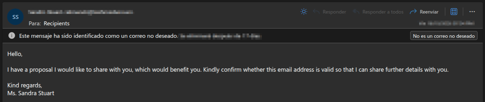
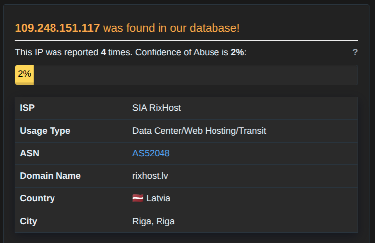
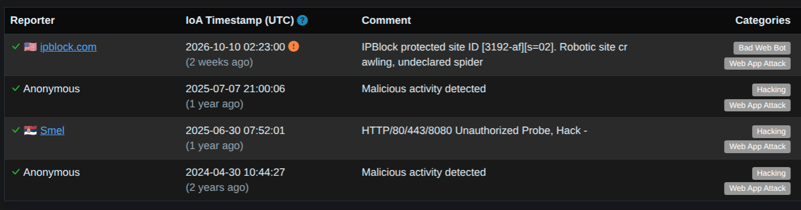
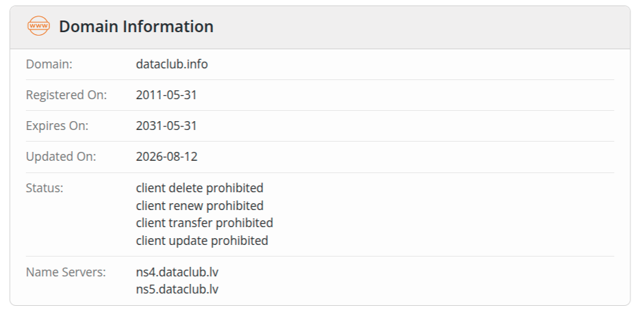
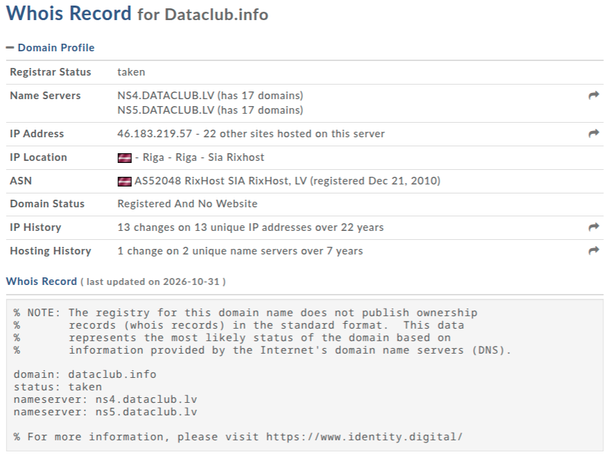
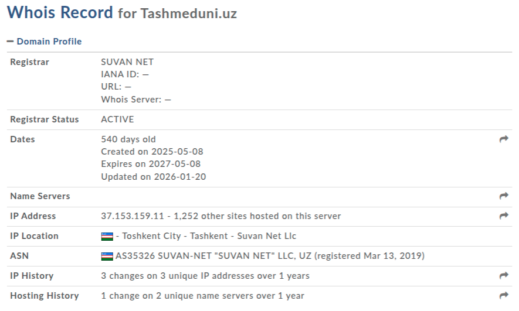
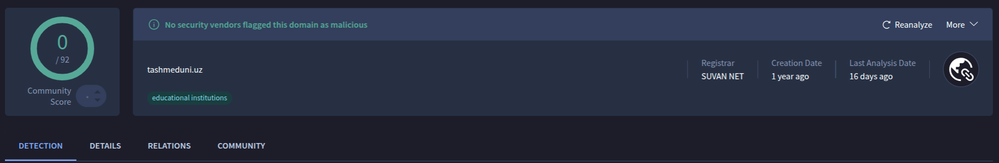
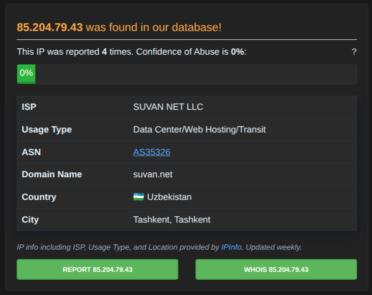
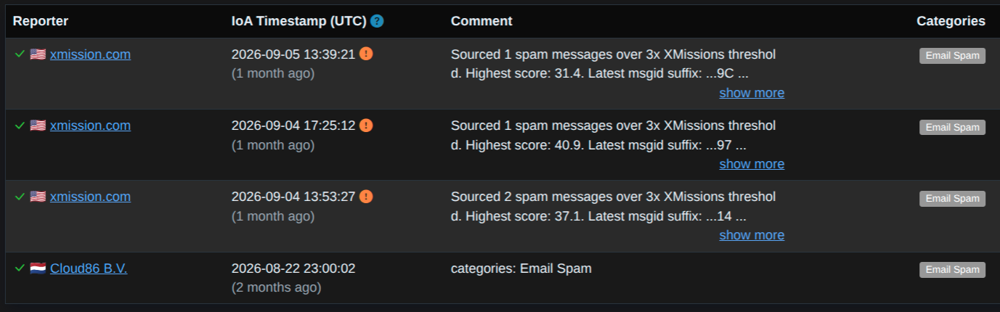

# Investigación de posible correo de phishing

## Resumen
El correo llegó a la bandeja de **Correo no deseado** a mi cuenta de Outlook a mediados de octubre del presente año.



En primera instancia, el saludo es completamente genérico: *Hello*. No pone ningún nombre. Seguidamente, hace una *propuesta* que quiere compartir conmigo pero sin dar más detalles hasta que envíe un correo para 'validar' que mi email existe.

**Hipótesis inicial**
El email es un sondeo de validación (email validation). Alguna antesala de otro correo de ingeniería social. El actual correo no contiene ningún archivo adjunto ni enlace.

## Investigación

>Se descarga el correo en formato `.eml` para empezar la investigación.

### Análisis de los encabezados `Received`

```shell
$ cat 'Received' Proposal.eml
```

Los `Received` más relevantes son, por orden:
- `Received: from mail.tashmeduni.uz (85[.]204[.]79[.]43)`
- `Received: IP-151-117.dataclub[.]info ([109[.]248[.]151[.]117])`

Se busca el servidor email obtenido en [VirusTotal](https://www.virustotal.com):


En **VirusTotal** -> **0/92** motores de seguridad no lo marcan como malicioso y el dominio fue registrado hace 15 años.

Buscando a través de [AbuseIPDB](https://www.abuseipdb.com/)



 - **ISP**: SIA RixHost
 - **Utilización**: Centro de datos o Web Hosting.
 - **Ubicación**: Letonia



Tres de los cuatro reportes coinciden en que es `Hacking` y los cuatro coinciden en que es un `Web App Attack`. El Web Hosting puede ser el responsable de estos reportes.

### Revisando el dominio `dataclub[.]info`

> En **AbuseIPDB**, se ha reportado al menos cuatro veces. No se puede asegurar que el dominio `dataclub[.]info` sea estrictamente malicioso.





- **Año de registro**: 2011-05-31
- **Año de actualización**: 2026-08-12
- **Estado**: `clientDeleteProhibited`, `clientRenewProhibited`, `clientTransferProhibited`, `clientUpdateProhibited` (bloqueos de seguridad)
- **Servidores**: `ns4.dataclub[.]lv` / `ns5.dataclub[.]lv`

El dominio fue registrado el 31 de mayo de 2011 (2011-05-31) y fue actualizado el 12 de agosto de 2026 (2026-08-12), (poco antes de recibir el correo a mediados de octubre). El dominio `dataclub[.]info` parece ser uno legítimo y no malicioso.

### Buscando mediante `Return-Path`

```shell
$ cat 'Return-Path' Proposal.eml
Return-Path: abruev.b@tashmeduni[.]uz
```



- **Fecha de creación**: 2025-05-08
- **Fecha de actualización**: 2026-01-20
- **Ubicación**: Tashkent, Uzbekistán



En **VirusTotal** -> **0/92** motores de búsqueda no lo marcan como malicioso. Además está marcado como perteneciente a una institución educacional.

### Buscando mediante la IP de origen

```shell
$ cat 'IP' Proposal.eml
Authentication-Results: mx.microsoft.com 1; spf=pass (sender IP is
Received: from IP-151-117.dataclub[.]info ([109[.]248[.]151[.]117])
X-Sender-IP: 85[.]204[.]79[.]43
```

Se hace una búsqueda en **AbuseIPDB**:



- **ISP**: SUVAN NET LLC
- **Uso**: Centro de datos o Web Hosting
- **Ubicación**: Uzbekistán



Todos los reportes coinciden que solo es un Email spammer.
## Conclusión
Tras el análisis de los encabezados, dominios e IPs, se puede concluir que solo es un emisor de spam de email, un sondeo de validación de correos.

### Evidencias relevantes
- Saludo genérico y una solicitud de validación de (mi) email
- Sin archivos o enlaces adjuntos en el correo
- El emisor del correo (`tashmeduni[.]uz`) pertenece a una institución educativa, su IP ha sido marcada como emisora de spam
- El hostname (`dataclub[.]`) y el host (SISA RixHost) es legítimo

A pesar de no tener un indicativo de ser un correo de pishing, se recomienda tener precaución en un futuro con este dominio.
