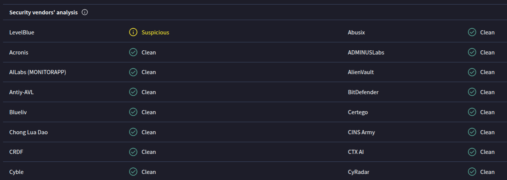

# Investigación — Posible correo de phishing con robo de datos bancarios
El correo llegó a la bandeja de **Correo no deseado** en mi cuenta de Outlook a principios del mes de noviembre del presente año. El emisor del correo tiene un nombre genérico: **Cloud Support**, no hace mención al supuesto servicio de almacenamiento de la nube como Google Drive, Dropbox, etc.


A primera vista el correo adjunta una imagen de un supuesto chat explicando la situación de la cuenta de la nube. La ventana del chat tiene un nombre completamente genérico: **Cloud Support**.


Al llegar hasta el final del supuesto chat con soporte técnico, aparece un botón al que se le puede hacer clic que lleva a un sitio externo para 'modificar' el método de pago.

##### Hipótesis inicial
El email es un correo de phishing que se hace pasar por un servicio de almacenamiento en la nube (**impersonate**). El enlace lleva a un sitio web desconocido donde se le solicitará a la víctima que introduzca sus datos bancarios para clonar la tarjeta asociada y realizar compras no autorizadas.

## Investigación

> Se descargó el correo en formato `.eml` para realizar esta investigación

### Análisis de los encabezados `Received`

```shell
$ grep 'Received' New-Message_Your-payment-was-declined.eml
```

Los encabezados más relevantes por orden son:
- `Received-SPF.............................................Pass (protection[.]outlook[.]com: domain of urbandfgora[.]shop`
- `Received.................................................from urbandfgora[.]shop (20[.]110[.]181[.]37)`

Se busca el servidor email en [VirusTotal](https://www.virustotal.com):


En **VirusTotal**: **0/92** motores lo marcan como malicioso sin embargo, hay que destacar que al menos un motor lo marca como sospechoso:



Buscando a través de [AbuseIPDB](https://www.abuseipdb.com/check/20.110.181.37):


Datos de interes:
- **ISP**: Microsoft Corporation
- **Utilización**: Centro de datos o Web Hosting
- **Ubicación**: Estados Unidos de América

La IP tiene actividad reciente y contiene diez reportes, de los cuales cuatro coinciden que es `Phishing` y `Spoofing`, y todos coinciden que es un `Email Spam`:


Se busca el header `Authentication-Results`. SPF, DKIM y DMARC pasaron con éxito (`pass`), sin embargo no significa que sea fiable. Debido a la condición de `pass`, Exchange no sospechó de ellos.

```shell
$ grep -e 'spf' -e 'dkim' -e 'dmarc' New-Message_Your-payment-was-declined.eml

Authentication-Results: mx.microsoft.com 1; spf=pass (sender IP is
 20[.]110.181[.]37) smtp.mailfrom=urbandfgora[.]shop; dkim=pass (signature was
 verified) header.d=urbandfgora[.]shop;dmarc=pass action=none
 header.from=urbandfgora[.]shop;compauth=pass reason=100
```

Posteriormente se busca el header `Message-ID`. El identificador resultante es: `geopod-ismtpd-4-4` y coincide con la plataforma **SendGrid**. Pero para determinar que sea parte de la infraestructura de SendGrid, en los headers debe de aparecer `X-SG-EID` o `X-SG-ID` propios de este proveedor, pero no hay resultados.

## Revisando el dominio `urbanfgora[.]shop`