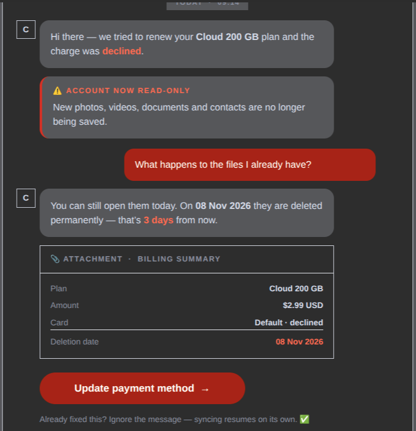
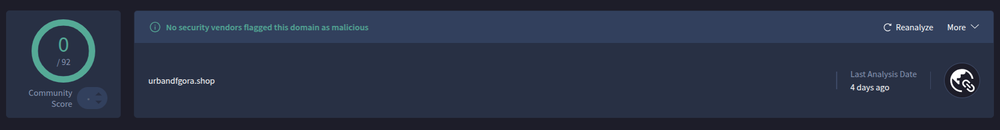
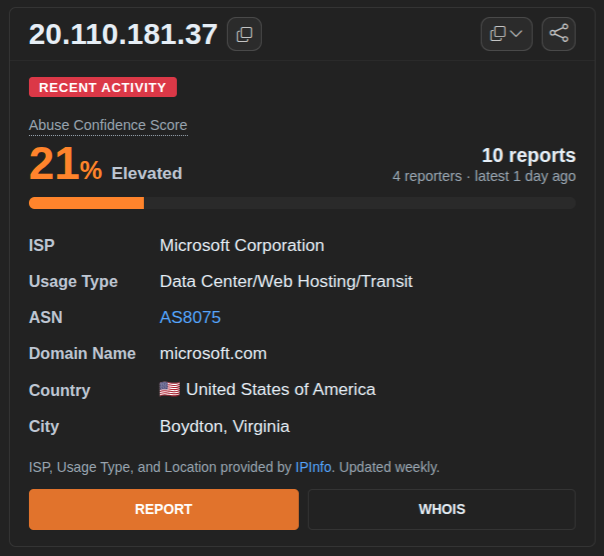
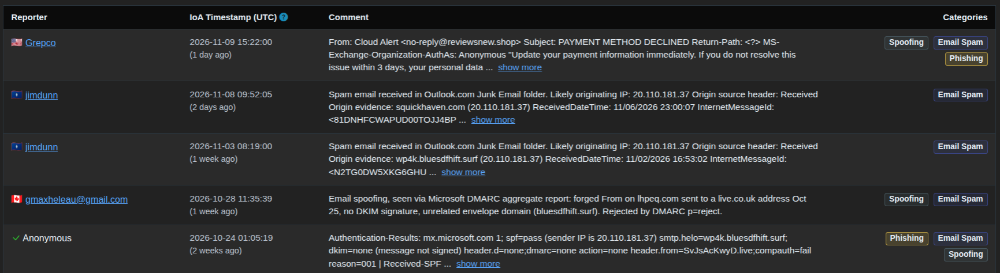

# Investigación — Posible correo de phishing con robo de datos bancarios
El correo llegó a la bandeja de **Correo no deseado** en mi cuenta de Outlook a principios del mes de noviembre del presente año. El emisor del correo tiene un nombre genérico: **Cloud Support**, no hace mención al supuesto servicio de almacenamiento de la nube como Google Drive, Dropbox, etc.


A primera vista el correo adjunta una imagen de un supuesto chat explicando la situación de la cuenta de la nube. La ventana del chat tiene un nombre completamente genérico: **Cloud Support**.



Al llegar hasta el final del supuesto chat con soporte técnico, aparece un botón al que se le puede hacer clic que lleva a un sitio externo para 'actualizar' el método de pago.

##### Hipótesis inicial
El email es un correo de phishing que se hace pasar por un servicio de almacenamiento en la nube (**impersonate**). El enlace lleva a un sitio web desconocido donde se le solicitará a la víctima que introduzca sus datos bancarios para clonar la tarjeta asociada y realizar compras no autorizadas.

## Investigación

> Se descargó el correo en formato `.eml` para realizar esta investigación

### Análisis de los encabezados `Received`

```shell
$ grep 'Received' New-Message_Your-payment-was-declined.eml
```

Los encabezados más relevantes por orden son:
- `Received-SPF.............................................Pass (protection[.]outlook[.]com: domain of urbandfgora[.]shop`
- `Received.................................................from urbandfgora[.]shop (20[.]110[.]181[.]37)`

Se busca el servidor email en [VirusTotal](https://www.virustotal.com):



En **VirusTotal**: **0/92** motores lo marcan como malicioso sin embargo, hay que destacar que al menos un motor lo marca como sospechoso:


Buscando a través de [AbuseIPDB](https://www.abuseipdb.com/check/20.110.181.37):



Datos de interes:
- **ISP**: Microsoft Corporation
- **Utilización**: Centro de datos o Web Hosting
- **Ubicación**: Estados Unidos de América
- **ASN**: Azure

La IP tiene actividad reciente y contiene diez reportes, de los cuales cuatro coinciden que es `Phishing` y `Spoofing`, y todos coinciden que es un `Email Spam`:




Se busca el header `Authentication-Results` para verificar la 'autenticidad' del correo. SPF, DKIM y DMARC pasaron con éxito (`pass`), sin embargo no significa que sea fiable. Debido a la condición de `pass`, Exchange no sospechó de ellos.

```shell
$ grep -e 'spf' -e 'dkim' -e 'dmarc' New-Message_Your-payment-was-declined.eml

Authentication-Results: mx.microsoft.com 1; spf=pass (sender IP is
 20[.]110.181[.]37) smtp.mailfrom=urbandfgora[.]shop; dkim=pass (signature was
 verified) header.d=urbandfgora[.]shop;dmarc=pass action=none
 header.from=urbandfgora[.]shop;compauth=pass reason=100
```

Posteriormente se busca el header `Message-ID`. El identificador resultante es: `geopod-ismtpd-4-4` y coincide con la plataforma **SendGrid**. Pero para determinar que sea parte de la infraestructura de **SendGrid**, en los headers deben de aparecer `X-SG-EID` y/o `X-SG-ID` propios de este proveedor, pero no hay resultados.

## Revisando el dominio `urbandfgora[.]shop`

> En **AbuseIPDB** se ha reportado 10 veces. En algunos de los reportes se puesto la etiqueta de *phshing* y *spoofing*, se comienza a indagar sobre el dominio.


Datos de interés:
- **Año de registro**: 2026-05-31
- **Año de actualización**: 2026-09-10
- **Estado**: `clientTransferProhibited` (bloqueos de seguridad)
- **Servidores**: `dns1[.]registrar-servers[.]com`, `dns2[.]registrar-servers[.]com`

El dominio fue registrado el 31 de mayo de 2026 (**2026-05-31**) y actualizado el 10 de septiembre de 2026 (**2026-09-10**), un mes antes de recibir el correo a principios de noviembre. Que el registro haya sido a mediados del presente año es sospechoso. Unos cuantos meses después (~6 meses aproximadamente) comenzó a tener una gran actividad (dos meses atrás según los reportes de **AbuseIPDB**).

Por último, se suma la presunta manipulación del header `Message-ID`, que hizo que superara los filtros de autenticidad gracias a que se suplantó una infraestructura conocida, por lo tanto se puede confirmar el spoofing.

## Prueba del enlace adjunto

> [!IMPORTANT]
> Se utilizó el servicio [Hybrid Analysis](https://www.hybrid-analysis.com) como sandbox para esta prueba.

> Se ejecuta una prueba para determinar el comportamiento del enlace malicioso (el enlace estaba adjunto en el supuesto chat con soporte técnico).

El enlace es el siguiente:

```
hxxp[://]nivellafinds[.]store/cl/33919_md/1007/11131474/2109/1051/6aeb1b9a691557fb45845073
```

Una vez ejecutadas las pruebas, se obtuvieron los siguientes resultados:


- **Amenaza**: 75/100, se confirma como malicioso
- **Detección de AV**: 0/6 (4 sin resultados, 1 limpio y 1 sin clasificación)
- **IOC**: 1 malicioso, 1 sospechoso y 17 informativos

### Indicadores de Compromiso (IOC)

#### [ATT&CK ID: T1204](https://attack.mitre.org/techniques/T1204/): User Execution


Un atacante puede aprovechar ciertas acciones de un usuario para lograr la ejecución a través de ingeniería social como abrir un documento o enlace malicioso. Los adversarios también pueden engañar a los usuarios para realizar acciones como:
- Habilitar herramientas de acceso remoto para permitir control directo del sistema
- Ejecutar JS malicioso en el navegador permitiendo a los adversarios robar cookies de sesiones
- Descargar y ejecutar malware para que el usuario lo ejecute
- Coaccionar al usuario para copiar, pegar y ejecutar código manualmente

#### [ATT&CK ID: T1583.001](https://attack.mitre.org/techniques/T1583/001/): Acquire Infrastructure: Domains


Los adversarios podrían adquirir dominios que pueden utilizar durante los ataques dirigidos. Pueden comprar o en algunos casos adquirirlos gratis. Los atacantes pueden elegir dominios que sean similares a dominios legítimos, incluso mediante el uso de homógrafos o de un dominio de nivel superior (TLD) diferente.

#### [ATT&CK ID: T1071.001](https://attack.mitre.org/techniques/T1071/001/): Application Layer Protocol: Web Protocols
Los adversarios podrían comunicarse usando protocolos en la capa de aplicación que se asocien con el tráfico web para evitar la detección o el filtrado de la red mezclándose con el tráfico existente. Los protocolos como **HTTP/S** y **WebSocket** que llevan el tráfico son muy comunes en varios entornos.

### Análisis de red
El enlace hace múltiples peticiones DNS a servicios de Google. Con base en los IOC, el atacante intenta hacer que el usuario introduzca sus credenciales de su cuenta de Google (**T1204**). Como el el adversario recientemente adquirió una nueva infraestructura (**T1583.001**), el enlace no puede establecer conexión.


El tráfico HTTP muestra el mismo patrón de comportamiento, múltiples peticiones a servicios de Google, posiblemente intentando obtener acceso a la cuenta del usuaro:


> Reporte completo: https://hybrid-analysis.com/sample/ddf80efb765c9e0d806835e102273478463d1c1005cd812f605047e3e8a6ff17/6af655b2f550cab8d50ca0c1


