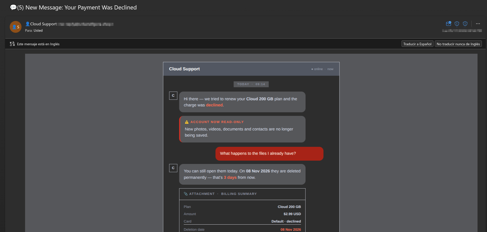
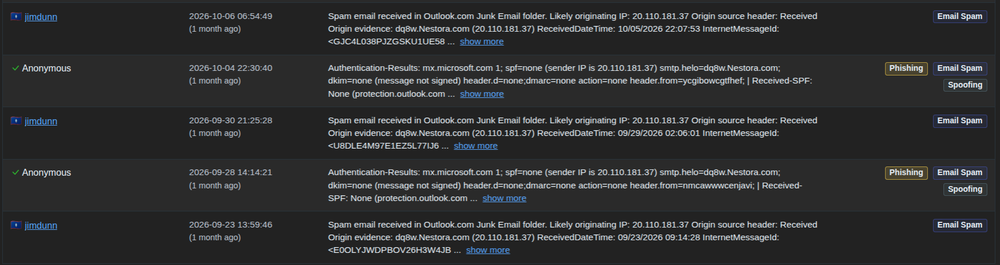

# Investigación — Posible correo de phishing con robo de datos bancarios
El correo llegó a la bandeja de **Correo no deseado** en mi cuenta de Outlook a principios del mes de noviembre del presente año. El emisor del correo tiene un nombre genérico: **Cloud Support**, no hace mención al supuesto servicio de almacenamiento de la nube como Google Drive, Dropbox, etc.



A primera vista el correo adjunta una imagen de un supuesto chat explicando la situación de la cuenta de la nube. La ventana del chat tiene un nombre completamente genérico: **Cloud Support**.


Al llegar hasta el final del supuesto chat con soporte técnico, aparece un botón al que se le puede hacer clic que lleva a un sitio externo para 'actualizar' el método de pago.

##### Hipótesis inicial
El email es un correo de phishing que se hace pasar por un servicio de almacenamiento en la nube (**impersonate**). El enlace lleva a un sitio web desconocido donde se le solicitará a la víctima que introduzca sus datos bancarios para clonar la tarjeta asociada y realizar compras no autorizadas.

---
## Investigación

> Se descargó el correo en formato `.eml` para realizar esta investigación

### Análisis de los encabezados `Received`

```shell
$ grep 'Received' New-Message_Your-payment-was-declined.eml
```

Los encabezados más relevantes por orden son:
- `Received-SPF.............................................Pass (protection[.]outlook[.]com: domain of urbandfgora[.]shop`
- `Received.................................................from urbandfgora[.]shop (20[.]110[.]181[.]37)`

Se busca el servidor email en [VirusTotal](https://www.virustotal.com):


En **VirusTotal**: **0/92** motores lo marcan como malicioso sin embargo, hay que destacar que al menos un motor lo marca como sospechoso:


Buscando a través de [AbuseIPDB](https://www.abuseipdb.com/check/20.110.181.37):


Datos de interes:
- **ISP**: Microsoft Corporation
- **Utilización**: Centro de datos o Web Hosting
- **Ubicación**: Estados Unidos de América
- **ASN**: Azure

La IP tiene actividad reciente y contiene diez reportes, de los cuales cuatro coinciden que es `Phishing` y `Spoofing`, y todos coinciden que es un `Email Spam`:




Se busca el header `Authentication-Results` para verificar la 'autenticidad' del correo. SPF, DKIM y DMARC pasaron con éxito (`pass`), sin embargo no significa que sea fiable. Debido a la condición de `pass`, Exchange no sospechó de ellos.

```shell
$ grep -e 'spf' -e 'dkim' -e 'dmarc' New-Message_Your-payment-was-declined.eml

Authentication-Results: mx.microsoft.com 1; spf=pass (sender IP is
 20[.]110.181[.]37) smtp.mailfrom=urbandfgora[.]shop; dkim=pass (signature was
 verified) header.d=urbandfgora[.]shop;dmarc=pass action=none
 header.from=urbandfgora[.]shop;compauth=pass reason=100
```

El header `Message-ID` contiene el identificador: `geopod-ismtpd-4-4`, y coincide con la plataforma **SendGrid**. Pero para determinar que sea parte de la infraestructura de **SendGrid**, los headers característicos (de **SendGrid**) `X-SG-EID` o `X-SG-ID` no hay resultados de dichos encabezados que determinen el uso de la infraestructura.

## Revisando el dominio `urbandfgora[.]shop`

> En **AbuseIPDB** se ha reportado 10 veces. En algunos de los reportes se puesto la etiqueta de *phshing* y *spoofing*, se comienza a indagar sobre el dominio.


Datos de interés:
- **Año de registro**: 2026-05-31
- **Año de actualización**: 2026-09-10
- **Estado**: `clientTransferProhibited` (bloqueos de seguridad)
- **Servidores**: `dns1[.]registrar-servers[.]com`, `dns2[.]registrar-servers[.]com`

El dominio fue registrado el 31 de mayo de 2026 (**2026-05-31**) y actualizado el 10 de septiembre de 2026 (**2026-09-10**), y comenzó a generar actividad maliciosa (según los reportes de **AbuseIPDB**) dos meses antes de recibir el correo. Que el registro sea tan nuevo y los reportes de abuso son indicadores de riesgo altos.

## Análisis del enlace malicioso

> [!IMPORTANT]
> Se utilizó el servicio [Hybrid Analysis](https://www.hybrid-analysis.com) como sandbox.

Enlace analizado (neutralizado):

```
hxxp[://]nivellafinds[.]store/cl/33919_md/1007/11131474/2109/1051/6aeb1b9a691557fb45845073
```

### Resultados en Hybrid Analysis


- **Amenaza**: 75/100, se confirma como malicioso
- **Detección de AV**: 0/6
- **IOC**: 1 malicioso, 1 sospechoso y 17 informativos

**Reporte completo**: \
https://hybrid-analysis.com/sample/ddf80efb765c9e0d806835e102273478463d1c1005cd812f605047e3e8a6ff17/6af655b2f550cab8d50ca0c1

## Indicadores de Compromiso (IOC) y técnicas ATT&CK

> [!NOTE]
> De los indicadores reportados anteriormente, se destacan las técnicas **ATT&CK** más relevantes para este caso

| Técnica                                                   | Descripción                                                                                                                    | Observaciones                                                                         |
| --------------------------------------------------------- | ------------------------------------------------------------------------------------------------------------------------------ | ------------------------------------------------------------------------------------- |
| **T1204** — User Execution                                | El atacante depende de que el usuario interactúe con el contenido, independientemente si es un enlace o un documento malicioso | El correo usa ingeniería social con un chat falso para "actualizar" el método de pago |
| **T1583.001** — Acquire Infrastructure: Domains           | Un atacante puede adquirir un dominio para usar en la infraestructura del ataque                                               | Dominios `urbandfgora[.]shop` y `nivellafinds[.]shop`                                 |
| **T1071.001** — Application layer protocol: Web Protocols | Uso de protocolos como HTTP/S para evadir detección y comunicarse                                                              | El enlace genera tráfico a dominios de google                                         |
## Análisis de red
Durante la ejecución del sandbox, el enlace hace múltiples peticiones DNS y HTTP/S a servicios de Google. Con base en los IOC, el atacante intenta hacer que el usuario introduzca sus credenciales de su cuenta de Google (**T1204**), posiblemente un intento de **credential harvesting**. La prueba no pudo establecer conexión completa, posiblemente a que la infraestructura del atacante estaba desactivada temporalmente.

> En el reporte completo aparecen capturas relacionadas con este comportamiento descrito


